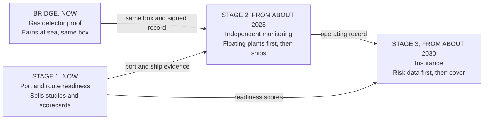
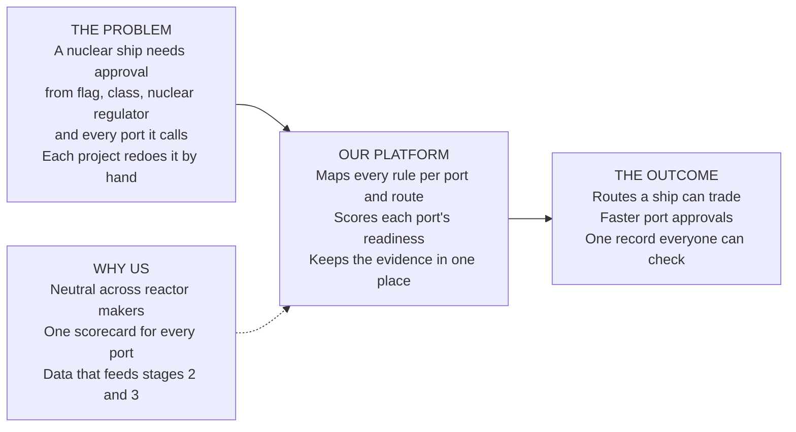
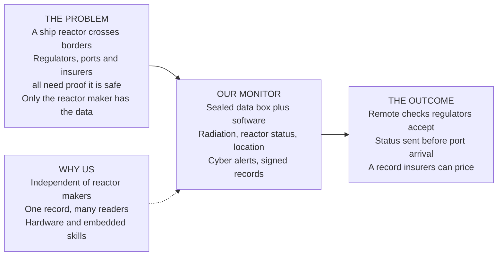
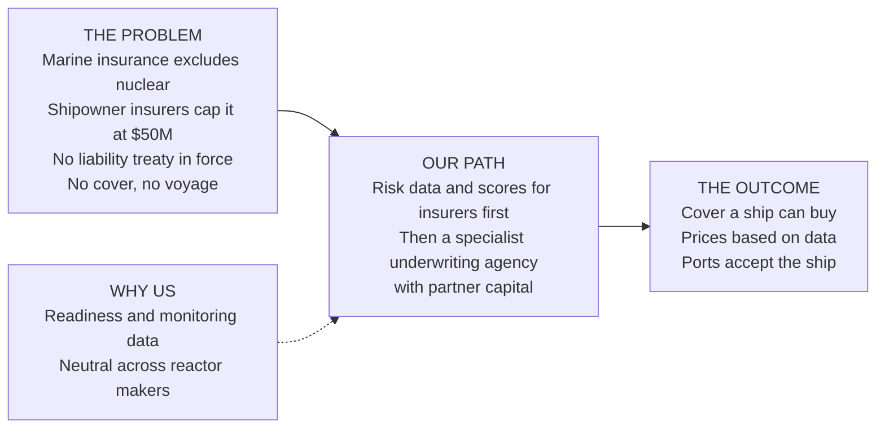
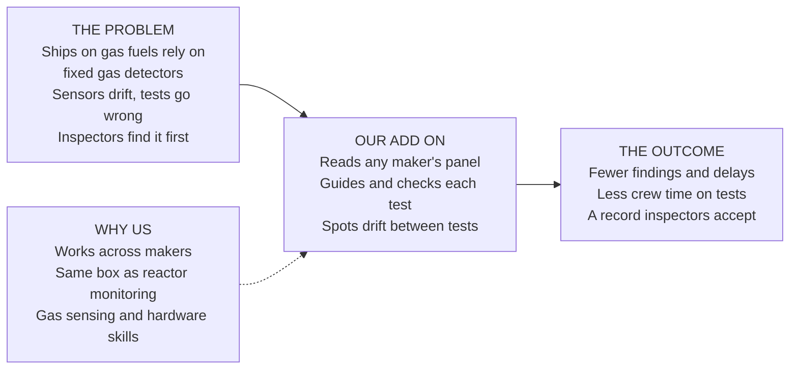

# Nuclear Shipping Lab

**Three product ideas for the layer around ship reactors, tested after our lead startup, [Kairos](https://github.com/tinha04/Kairos): port and route readiness for nuclear ships, independent reactor monitoring, and insurance for nuclear ships. Plus a bridge idea that ships need today, proof that ship gas detectors work, and one backup idea in research.**

| Rank | Idea | YC score | Verdict | Next step |
|---|---|---|---|---|
| Bridge | **Proof that ship gas detectors work** (new) | 23/35 | Improved, not new. Highest score: ships running on gas fuels need it now, it uses the same box and record as reactor monitoring, and it fits our hardware skills. Each detector maker serves only its own systems | 8 ship manager calls: would you pay per ship for drift warnings and an inspector ready record? |
| 1 | **Port and route readiness for nuclear ships** | 21/35 | Improved, not new. Strongest why now and the most likely to earn revenue before ships exist. A UK consortium led by Lloyd's Register, the industry group NEMO, the UN nuclear agency and Core Power already do this as studies and free guidance | Call our industry contact, then 10 buyer calls: will ports and owners pay for readiness work now? |
| 2 | **Independent monitoring for ship reactors** | 20/35 | Improved, not new. Best fit with our hardware skills, but no reactor runs at sea before about 2030 and reactor makers hold the data | 5 reactor developer calls: will they share read only data? Start with floating power plants |
| 3 | **Insurance for nuclear ships** | 18/35 | Strongest problem, weakest position. Specialist nuclear insurers are moving in; we have no license, no capacity and no ships to insure yet | 6 insurer calls: will anyone pay for risk data before ships exist? |
| Backup | Shielding and layout optimizer | 18/35 | Research only. Real cost in weight and cargo space, but shipyards and reactor makers do this in house | One question in every call: is shielding a bottleneck you would pay to fix? |

## Scope

- **What we build:** readiness, monitoring and risk tools around ship reactors. Never reactor design, fuel handling, weapons or naval propulsion. Monitoring is read only and never touches reactor control.
- **Where we stand:** research done and stress tested against outside sources (October 2026); one industry contact who works on modular nuclear power for ships; 0 interviews, 0 users, 0 revenue. Interviews start after Kairos's YC application on November 2.
- **What the research found:** none of the three opens a new category; each improves on work others already do. Our case rests on being neutral across reactor makers and reusing one record for ports, regulators and insurers ([stress test](docs/yc-review.md#5-stress-test-new-or-better-2026-10-07)).
- **Structure:** the ideas can be one company in stages: gas detector proof and readiness now, monitoring when reactors run, insurance once there is data (proposal, [decisions](docs/decisions.md)). It would be separate from Kairos.
- **Strongest YC pitch today (proposal):** proof that ship gas detectors work, with reactor monitoring as the long term vision.

---

## 1. Port and route readiness for nuclear ships

### What we do

### The problem

- **A ship that can't enter ports can't trade:** Germany's nuclear cargo ship Otto Hahn was admitted to only about 33 ports in 22 countries, each after diplomatic talks. New Zealand still bans nuclear powered ships within 12 miles of its coast.
- **The barrier is paperwork, not engineering:** a June 2026 study by Lloyd's Register, the Port of Rotterdam, Core Power and Maersk found the main barriers are regulatory alignment, governance, risk management and public acceptance.
- **Five rulebooks are being rewritten at once:** the UN shipping agency (IMO) is rewriting its nuclear ship code for 2030; the US nuclear regulator (NRC) and Coast Guard signed a new agreement in 2026 and a maritime paper is due this fall; the UN nuclear agency (IAEA) launched a maritime program with 26 countries in August 2026; ship classification societies are writing their own rules.
- **Projects are lining up:** three early design approvals for nuclear ships since June 2026, a US plan for 50 nuclear merchant ships (first delivery targeted for 2033), and a nuclear car carrier study between the US and South Korea announced this month.
- **Every port study starts from zero:** Rotterdam and Corpus Christi each ran their own study. The industry group NEMO's practical port guide is not due until 2027.

### Our solution

1. **Maps the rules:** a live map of every requirement a nuclear ship call triggers, by port, flag, class society and reactor type, each with its source.
2. **Scores each port:** a readiness scorecard (emergency plans, berths, radiation checks, security, local law, public acceptance) built from the questions the Rotterdam and Corpus Christi studies asked.
3. **Plans routes:** shows which routes a ship could trade today and what is missing on each, including canals and national bans.
4. **Keeps the evidence:** one shared record per ship and port that the owner, port, class society, regulator and insurer can each check.
5. **Answers questions with sources:** search across IMO, IAEA, NRC, Coast Guard and class documents, every answer cited.

We advise and document. Class societies and regulators keep every approval.

### Competitors

| Company | What they do | Pain point they solve | Pain point we solve | Different? |
|---|---|---|---|---|
| **Lloyd's Register's Maritime Nuclear Consortium** (with Rolls-Royce, Babcock, a security firm, a law firm and an insurer) | Class approval framework, security rules, insurance pathways and guidance for a UK led fleet (from January 2026) | Standards for their own fleet and reactor | Neutral, repeatable tool for any port, reactor and class society | **Partly.** Biggest threat; possible channel |
| **Core Power** (with Rotterdam and Corpus Christi) | One off port feasibility studies for its own ships | One port at a time | The same questions as a template across many ports | **Partly.** May keep this in house |
| **NEMO** (33 members) and **IAEA's ATLAS program** (26 countries) | Industry guidance and an international framework | Rules and guidance, free to members | Applying the rules to one ship, port and route | **Partly.** Free substitute for the basics; source for our map |
| **Class societies** (ABS, Lloyd's Register, DNV, Bureau Veritas) | Nuclear rules, "nuclear ready" ship designs, early design approvals | Ship and reactor design approval | The port and route side, across class societies | **Partly.** Partners |
| **Law and advisory firms** (Stephenson Harwood, Pillsbury, Hogan Lovells, Orrick, Global Nuclear Security Partners) | Bespoke regulatory and security advice | Expert judgment per project | Software that cuts their hours | **Partly.** Users or rivals |
| **Everstar, Atomic Canyon** | AI tools for nuclear licensing and plant documents | Land reactor licensing | Ship, port, flag and route rules | **Partly.** Closest software rivals; could add maritime |

### Why us

- **Neutral:** we are not tied to one reactor maker or class society. Core Power and the Lloyd's Register consortium each serve their own projects.
- **Repeatable:** one scorecard for every port, built from published study questions, so each new port adds to a network.
- **Access:** our industry contact works on modular nuclear power for ships and can be the first design partner.
- **Weak spot:** no nuclear or maritime regulatory expert on the team, incumbents give guidance away, and buyers are few.

### How we can succeed

1. **Start with our contact:** a free rule map and scorecard for one ship concept and three ports on its intended route, in 4 weeks.
2. **Sell to ports next:** paid readiness scorecards for US ports, which MARAD is already working with; port grant programs can fund some of the work.
3. **Become the shared record (the bet we are testing):** a yearly fee per ship and per port once ships are in design, because every party needs the same evidence.
4. **Bring in experts:** a former NRC or Coast Guard official and a nuclear lawyer as advisors.
5. **Grow:** into monitoring (idea 2) and insurance data (idea 3).

**We stop if:** fewer than 3 of 10 buyers would pay for a scorecard, a free tool from Lloyd's Register, NEMO or the IAEA covers port scoring, or our contact's project stalls with no other design partner in 6 months.

### Market

- **First customers:** our contact's project, then reactor developers and shipowners planning routes, then ports (Corpus Christi, Long Beach, Rotterdam).
- **Size:** dozens of projects and ports today; about $15M to $50M a year in studies and subscriptions once ships are in design (estimate). Above that needs a fleet that trades, or stages 2 and 3 on the same record.
- **Why now:** the US 50 ship plan (construction from 2028), the IAEA program launched August 2026, the NRC maritime paper due this fall, the IMO code due 2030, three early design approvals since June 2026.
- **Caution:** first ships arrive 2030 to 2033 at the earliest, and one industry outlet says routine port calls are "potentially decades" away. The IMO's carbon price vote this month could weaken the climate case.

### Status

| Stage | Status |
|---|---|
| Research and competitor analysis | Done and stress tested, October 2026 |
| Rule map and port scorecard | Steps ready ([build plan](docs/readiness/build-plan.md)); built from public sources |
| Buyer interviews | 0 of 10, plus our industry contact |

**Biggest open question:** will ports and owners pay for readiness work now, or wait for free guidance?

---

## 2. Independent monitoring for ship reactors

### What we do

### The problem

- **No one knows how to inspect a moving reactor:** the IAEA's approach for floating plants is "still being studied" because the plant crosses borders; satellite images help, but monitors and seals are still needed.
- **Rules now allow remote monitoring:** the NRC's proposed rule for small reactors (May 2026, final expected January 2027) allows monitoring and operation from outside the site.
- **Ships are cyber targets:** one maritime security firm counts a published cyber attack on shipping every three days. A nuclear ship would fall under ship cyber rules and reactor cyber rules at once.
- **Everyone needs the same data:** ports need it for emergency plans and security (Rotterdam study), insurers need it to price cover, and the IAEA needs it for nuclear material checks. Today it sits with the reactor maker.

### Our solution

1. **Sealed data box:** reads radiation monitors, reactor status, location and seals; signs every record; keeps working offline at sea.
2. **Shares by role:** the regulator, port, class society, insurer and IAEA each see what they are entitled to.
3. **Watches the network:** read only cyber monitoring where ship systems meet reactor systems.
4. **Tells the port before arrival:** a status packet sent ahead of each call, linked to the port's readiness file (idea 1).
5. **Builds the record insurers price:** operating history for each reactor.

Read only, one way data. Never part of reactor control or safety systems.

### Competitors

| Company | What they do | Pain point they solve | Pain point we solve | Different? |
|---|---|---|---|---|
| **Reactor makers** (BWXT, Westinghouse, Rolls-Royce) | Control and monitoring for their own reactors | Running their reactor safely | An independent record across makers that ports and insurers trust | **Partly.** Biggest threat: the maker provides it |
| **Mirion** | Radiation monitoring, including systems for naval ships and nuclear ship propulsion | Measuring radiation | Radiation, status, location and cyber in one shared record | **Partly.** Supplier |
| **ABB, Kongsberg** | Remote operations centers for ships | Ship performance and maintenance | Nuclear data that regulators and ports accept | **Partly.** Channel |
| **Cydome (with Rakuten), Xage, Industrial Defender** | Ship cyber security; reactor cyber compliance | One cyber rulebook each | Both rulebooks on one ship, plus the shared record | **Partly.** Partners |
| **Nuclearn, Atomic Canyon, Blue Wave AI** | AI for power plant operations and documents | Land plant operations | Mobile reactors at sea, across borders | **Partly.** Could move to ships |
| **US national labs** (Idaho, Oak Ridge, Argonne) | Research on remote monitoring and digital twins of small reactors | Methods | A product | **Yes.** Sources and partners |

### Why us

- **Independent:** we don't make reactors, so ports, regulators and insurers can trust our record.
- **Built for sea:** offline first, signed records, satellite sync; fits our hardware and embedded firmware skills.
- **One record, many readers:** each party gets its own view of the same data.
- **Weak spot:** nuclear grade approval and cyber certification take years, no reactor runs at sea yet, and reactor makers may refuse access.

### How we can succeed

1. **Start on floating power plants:** they come before ships. Bluecore is testing monitoring and sensors on an unfueled prototype at the Port of Long Beach. Meanwhile, prove the same box at sea with gas detectors (the bridge idea below) and prepare approvals and a shared data standard early ([prepare now](docs/monitoring/prepare-now.md)).
2. **Prove it on the bench first:** a data box that signs and stores 7 days of simulated reactor data offline, with a real radiation sensor.
3. **Pair it with readiness:** the pre arrival packet lives in the port's readiness file (idea 1).
4. **Charge per reactor per year (the bet we are testing)** once reactors are fueled.
5. **Feed insurance:** the record becomes risk data (idea 3).

**We stop if:** 3 of the first 5 reactor developers refuse read only access, regulators accept only the maker's data, or approval costs more than 24 months of runway.

### Market

- **First customers:** floating plant and small reactor developers, then nuclear ship operators.
- **Size:** about $0.3M to $1M per reactor a year (estimate). 50 US ships plus 20 floating plants is about $20M to $60M a year; land small reactors could multiply it.
- **Why now:** the NRC's remote monitoring rule, the IAEA program's safeguards group, new ship cyber rules, and fresh money for floating plants ($60M to Bluecore in 2026).
- **Caution:** the first fueled reactor at sea is likely 2028 or later.

### Status

| Stage | Status |
|---|---|
| Research and competitor analysis | Done and stress tested, October 2026 |
| Bench data box | Steps and indicative parts ready ([build plan](docs/monitoring/build-plan.md)); build starts after November 2 |
| Developer interviews | 0 of 8 |

**Biggest open question:** will reactor makers let a third party read their data, and will regulators accept it?

---

## 3. Insurance for nuclear ships

### What we do

### The problem

- **Excluded by default:** nuclear exclusions sit in almost all marine policies (international marine insurers' union, May 2026). The shipowners' liability insurers, which cover about 90% of ocean going ships, exclude nuclear risk from their shared reinsurance.
- **The cap is tiny:** one of the largest of those insurers can offer only $50M for nuclear claims in 2026 to 2027.
- **No treaty:** the 1962 nuclear ship liability convention never came into force. An IMO legal working group recommended starting a new one in January 2026.
- **History repeats:** the US nuclear cargo ship Savannah needed a $500M government guarantee because no private insurer would cover it.
- **Products don't exist yet:** Swiss Re says insurance for moving and running small reactors has not been built.

### Our solution

1. **Risk model per ship and route:** reactor type, readiness of each port on the route, crew, security and monitoring.
2. **Data room for underwriters:** readiness evidence (idea 1) and the operating record (idea 2) in one place.
3. **A narrow first cover (the bet we are testing):** pays when a port refuses or delays a nuclear ship, priced from readiness data. It needs no nuclear capital.
4. **Structure the full cover:** layer the shipowner insurer's $50M, nuclear pools and a government backstop with partner capital.
5. **Become an underwriting agency** once data and capital partners exist.

### Competitors

| Company | What they do | Pain point they solve | Pain point we solve | Different? |
|---|---|---|---|---|
| **Northcourt** (Optio) | Licensed nuclear property and liability underwriting agency since 2010, backed by Lloyd's insurers; launched Lloyd's first fusion facility | Nuclear plant cover | Ships: a moving reactor, ports and routes | **Partly.** Biggest threat and best partner |
| **Markel and Willis** | Nuclear property and business interruption facility, including small reactors (May 2026) | Plant property | Ship liability and port access | **Partly** |
| **Nuclear insurance pools** (American Nuclear Insurers, UK pool) | Nuclear liability for plants and transport | Plant liability under national law | Ships at sea, across borders | **Partly.** Capital partners |
| **NorthStandard and other shipowner insurers** | Normal marine liability; NorthStandard sits in the Lloyd's Register consortium | Everything but nuclear, up to $50M | Above the $50M cap | **Partly** |
| **AXA XL, Marsh** | Big insurer (joined NEMO in February 2026); big broker (placed cover for TerraPower's plant) | Capital and placement | Ship specific risk data | **Partly.** Partners or rivals |
| **Data driven insurers** (Descartes, Otonomi, FloodFlash) | Cover that pays on a measured trigger | Fast claims | Nuclear ship triggers (port refusal, monitored readings) | **Yes.** Model to copy |

### Why us

- **Data no one else has:** port readiness evidence (idea 1) and an independent operating record (idea 2).
- **Neutral:** not tied to a reactor maker, class society or insurer.
- **Weak spot:** no insurance license, no underwriting history, no capital relationships, and the market won't open until a treaty or government backstop exists.

### How we can succeed

1. **Don't start as an insurer:** sell risk scores and the data room to Northcourt, Markel and Willis, AXA XL and NorthStandard.
2. **Test the narrow first cover:** port refusal or delay, priced from readiness scores.
3. **Recruit a nuclear underwriter** as an advisor or co-founder.
4. **Track the treaty:** the IMO legal committee, the IAEA program's liability work and MARAD's insurance pathway.
5. **Become an underwriting agency** when a capital partner commits.

**We stop if:** no insurer would pay for risk data in 3 of 5 calls, no capital partner will work with us within 12 months, or no liability path exists by 2029.

### Market

- **First customers:** insurers and brokers buying risk data, then shipowners buying cover.
- **Size:** about $2M to $5M a year in nuclear premium per ship (estimate, no market quote yet). 50 ships is $100M to $250M in premium; at a 20% to 30% agency commission, about $20M to $75M a year, plus data fees and port refusal cover. Most of it waits for a liability treaty or government backstop.
- **Why now:** AXA XL joined NEMO, Markel and Willis opened a nuclear facility, the IMO legal group asked for a liability treaty, NEMO's insurance guide is due 2027, and MARAD asked industry for insurance pathways.
- **Caution:** no ship to insure before about 2030, and the premium per ship is our guess.

### Status

| Stage | Status |
|---|---|
| Research and competitor analysis | Done and stress tested, October 2026 |
| Risk model and port refusal cover | Outline ready ([build plan](docs/insurance/build-plan.md)) |
| Insurer interviews | 0 of 6 |

**Biggest open question:** will an insurer pay for risk data before ships exist, and who provides the capital?

---

## Bridge: Proof that ship gas detectors work

### What we do

### The problem

- **Inspectors keep finding the same faults:** on three LNG carriers in Boston, the US Coast Guard found gas sensors reading outside the maker's limits, failed calibrations and the wrong test gas. Cargo work was delayed, and such faults can mean detention. A large insurer of shipowners warned its members about the "alarming trends".
- **Gas carriers get detained more:** one US Coast Guard sector detained 5% of gas carriers it examined, against a 1.5% national average.
- **The record counts as much as the sensor:** inspectors treat an undocumented calibration as no calibration.
- **The fleet is growing fast:** about 1,100 ships can run on LNG, methanol or ammonia today and about 1,000 more are on order. The first ammonia ships arrived in 2026, and ammonia alarms start at 25 parts per million because it is toxic.

### Our solution

1. **Reads any maker's panel:** a small box reads the gas detection system's existing outputs. Read only, in a safe area, never changing alarms.
2. **Guides each monthly test:** an app walks the officer through every sensor and checks the test gas before it is used, catching the exact mistake the Coast Guard found.
3. **Spots drift between tests:** it tracks each sensor and compares similar sensors across the fleet, warning before a sensor fails.
4. **Keeps a signed record:** a tamper evident log of every test, with a one click report for inspectors, class and vetting, sent to the ship's maintenance system.
5. **Grows into nuclear:** the same box and record later serve radiation monitors and reactor monitoring.

Advisory only. The maker's system stays the approved safety system.

### Competitors

| Company | What they do | Pain point they solve | Pain point we solve | Different? |
|---|---|---|---|---|
| **Ship gas detection makers** (Consilium, Autronica, Dräger, Hanla IMS) | Fixed systems and service for their own equipment | Detect gas, meet class rules | One view and record across all makers; drift between services | **Partly.** Biggest threat if they add cloud health |
| **Industrial Scientific, Teledyne, Blackline, MSA** | Cloud records and automatic tests for portable detectors (about 475,000 on Industrial Scientific's alone) | Portable detector upkeep | Fixed systems built into the ship | **Yes for fixed.** Teledyne is closest at sea |
| **Martek Marine** | Portable detector with a tamperproof calibration certificate; test gas supply | Portable proof at sea | Fixed systems; drift between tests | **Partly.** Possible channel |
| **MSA, General Monitors, SMC** | Remote calibration of fixed detectors on land, each for its own brand | Less walking to sensors | Any maker, at sea, plus the record | **Partly** |
| **Ofiniti** (DNV spinout, $9M raised) | Digital records for each fuel delivery, including ammonia | Fuel paperwork | Safety sensor health | **Yes.** Partner |

### Why us

- **Works across makers:** ship managers run several makers' systems; each maker only sees its own.
- **Catches known mistakes before the inspector:** wrong test gas and out of range readings are checked at test time.
- **Same box as reactor monitoring:** signed records, offline first, read only; it proves our product at sea years before reactors sail.
- **Team:** hardware, embedded firmware and gas sensing work from our Idea Lab.
- **Weak spot:** the problem evidence dates from 2019 and 2020; makers or class could gatekeep the data; no shipping network beyond our contact.

### How we can succeed

1. **Start with ship managers that run several makers' systems,** with a free 3 month pilot on one ship.
2. **Prove it on the bench first:** at least 9 of 10 planted faults caught, including the wrong test gas.
3. **Charge per ship per year (the bet we are testing),** priced against delays, detentions and crew time.
4. **Partner:** fuel delivery records (Ofiniti) and test gas supply (Martek).
5. **Grow:** tankers and chemical carriers, then radiation monitors and reactor monitoring.

**We stop if:** fewer than 3 of 8 ship managers would pay $8,000 per ship a year, class requires a new approval taking over 12 months, or makers block access to most panels.

### Market

- **First customers:** managers of gas carriers and LNG fueled ships, then methanol and ammonia ship owners.
- **Size:** about $12M to $33M a year at modest adoption (estimate); more with tankers and the nuclear step.
- **Why now:** alternative fuel ship orders up 53% in 2026, the first ammonia ships and refueling trials, and fuel records going digital in Singapore and Rotterdam.
- **Caution:** the price per ship is a guess, some fleet counts are not verified, and newer inspection data may show the problem is smaller than in 2020.

### Status

| Stage | Status |
|---|---|
| Research and competitor analysis | Done, October 2026 ([full review](docs/gas-integrity/product-and-tech.md)) |
| Bench rig with planted faults | Steps and indicative parts ready ([build plan](docs/gas-integrity/build-plan.md)); build starts after November 2 |
| Ship manager interviews | 0 of 8 |

**Biggest open question:** will ship managers pay per ship for proof and drift warnings, beyond their maintenance logs and the maker's service?

---

## Backup: Shielding and layout optimizer (research only)

Software to cut the weight of a ship reactor's radiation shield and find the best place for it on the hull, so ships lose less cargo space. Korean studies put an optimized shield at about 10,500 tonnes, while removing fuel tanks frees only about 5% more container space. Rivals: reactor makers' and shipyards' own teams, ship design software (NAPA, Cadmatic), free radiation codes (OpenMC, MCNP), and AI simulation firms (PhysicsX, $300M raised in June 2026). Kept to grow if a shipyard or reactor maker says shielding is a bottleneck they would pay to fix ([research](docs/shielding/research.md)).

## Team

- **Technical co-founder:** hardware, embedded firmware, product.
- **Business co-founder:** customers, partners, grants and fundraising.
- **Industry contact:** works on modular nuclear power for ships; first design partner (to confirm).
- **Gaps:** nuclear regulation, maritime law, insurance underwriting, class approval for ship equipment.

Internal working docs (portfolio and scores, YC review, call playbook, method, decisions, sources, market landscape, the monitoring prepare now plan and niches, and per idea: product, market, competition, risks, build plan, YC review, evidence) are in [/docs](docs/). Session handoff: [CLAUDE.md](CLAUDE.md).
