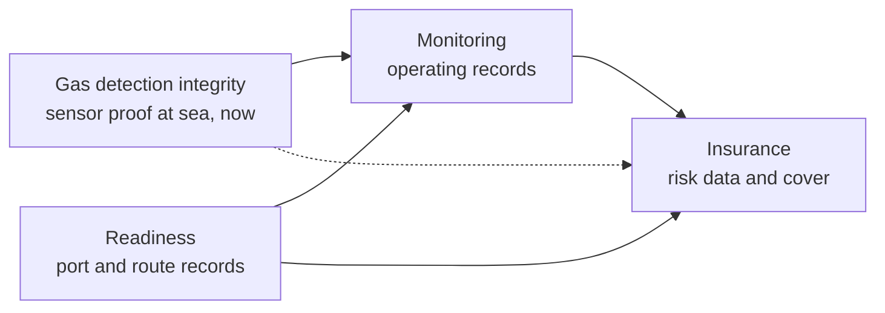

# Portfolio

[Back to README](../README.md) · [Method](method.md) · [YC review](yc-review.md) · [Landscape](landscape.md) · [Decisions](decisions.md) · [Sources](sources.md)

Three ideas for the layer around ship reactors, one bridge idea that earns at sea now (added 2026-10-07), and one backup, tested after Kairos. Scores follow the YC lens in [method.md](method.md).

## 1. Status

| Idea | YC score (35) | Tier | Verdict | Next step |
|---|---|---|---|---|
| [Gas detection integrity](gas-integrity/product-and-tech.md) (bridge) | **23, highest** | Exploring | Improved, not new. Ships need it today; same box and record as reactor monitoring. Portable detector clouds and single brand land tools exist; no maker neutral service for fixed systems at sea found. Problem data date from 2019 to 2020 | 8 ship manager calls; bench with seeded faults |
| [Port and route readiness](readiness/product-and-tech.md) | **21, rank 1** | Exploring | Improved, not new. Strongest why now; most likely to earn revenue before ships exist. Lloyd's Register consortium, NEMO, IAEA and Core Power cover the work as studies and free guidance; no software product found | Industry contact call, then 10 buyer calls |
| [Independent reactor monitoring](monitoring/product-and-tech.md) | **20, rank 2** | Exploring | Improved, not new. Best founder fit; demand waits for fueled reactors; makers hold the data | 5 developer calls on read only access; floating plants first |
| [Insurance for nuclear ships](insurance/product-and-tech.md) | **18, rank 3** | Exploring | Strongest problem, weakest position: no license, capital or ships yet; Northcourt, Markel and Willis, AXA XL and NorthStandard are moving | 6 insurer calls: will anyone pay for risk data now? |
| [Shielding and layout optimizer](shielding/research.md) | 18 | Backup | Research only; yards and makers do it in house | One question in every call |

**Overfitting warning:** 0 interviews. Gaps of 1 to 3 points are within judgment error. The order reflects speed to proof and why now more than size. The bridge leads by 2 points on one research pass.

## 2. How the three ideas fit (proposal)

- **One record, three products:** the port and ship evidence from readiness is what the monitoring box files before each call, and both are what insurers need to price.
- **The bridge (added 2026-10-07):** gas detection integrity runs on the same box and signed record as reactor monitoring, earns from gas fueled ships and gas carriers now, and builds the track record with class, ports and insurers that nuclear needs later ([niches](monitoring/niches.md)).
- **Revenue in order of arrival:** readiness and gas detection sell now, monitoring when floating plants fuel (about 2028), insurance when ships trade (about 2030).
- **Why one company (H):** each alone is tens of millions a year at most ([readiness](readiness/market.md#5-read-on-venture-scale), [monitoring](monitoring/market.md#5-read-on-venture-scale), [insurance](insurance/market.md#5-read-on-venture-scale)); together they share customers, data and trust. Waiting on Tin ([decisions](decisions.md#2-waiting-on-tin)).
- **Risk of one company:** three hard things at once with two founders. Mitigation: build only readiness until a kill or promote decision; keep the others in interviews.

## 3. Score cards (rounds 1 and 2, 2026-10-07)

| Criterion | Gas detection (bridge) | Readiness | Monitoring | Insurance | Shielding (backup) |
|---|---|---|---|---|---|
| Problem | 4 | 4 | 3 | **5** | 3 |
| Market | **3** | 2 | **3** | **3** | 2 |
| Insight | 3 | 3 | 3 | 3 | 3 |
| Differentiation | **3** | 2 | 2 | 1 | 2 |
| Founder fit | **3** | 2 | **3** | 1 | 2 |
| Speed to proof | **3** | **3** | 2 | 1 | **3** |
| Why now | 4 | **5** | 4 | 4 | 3 |
| **Total** | **23** | 21 | 20 | 18 | 18 |

**Score history (last known rounds):**

| Idea | Round 1 (2026-10-07) | Round 2 (2026-10-07, prepare now and bridge research) | Why |
|---|---|---|---|
| Gas detection integrity | n/a | 23 | First scored this round |
| Readiness | 21 | 21 | No new evidence on buyers |
| Monitoring | 20 | 20 | Prepare now work shortens later steps but proves nothing yet; 0 interviews |
| Insurance | 18 | 18 | Unchanged |
| Shielding | 18 | 18 | Unchanged |

## 4. Options considered and not chosen (2026-10-07)

| Option | Why not now | Revisit if |
|---|---|---|
| Nuclear crew training and staffing (ex Navy reactor operators into merchant crews) | Not chosen by Tin; NEMO's training task force and maritime academies are working on it [L19, L20] | A shipowner names crew as its biggest blocker |
| Reactor leasing or energy as a service | Capital heavy; Core Power's model with about $500M raised [L2, L3] | Never as a startup without a reactor partner |
| Building a reactor | Out of scope | n/a |
| Ammonia ships only as the bridge (2026-10-07) | 5 in service, 41 on order, 4 orders in 2026 ([gas evidence](gas-integrity/evidence.md)); folded into gas detection integrity | Ammonia orders pick up sharply |
| Spent fuel ships (INF Code) as a monitoring niche | 3 ships at PNTL; no new rule ([niches](monitoring/niches.md)) | A new tracking rule |

## 5. Lessons carried from the Idea Lab

| Lesson | How we applied it here |
|---|---|
| Check what incumbents already do before claiming a gap | Searched class societies, consortia, insurers and consultants, not only startups ([stress test](yc-review.md#5-stress-test-new-or-better-2026-10-07)) |
| Search logistics firms and integrators, not only product makers | Found the Lloyd's Register consortium, Core Power's port studies and Northcourt |
| A better product alone is not a company when funded players cover the need | Positioned all three on neutrality and a shared record, not on technology |
| Check the adoption bottleneck before building | The bottleneck is ports, rules and insurance, so we build there and not in reactors |
| Size a niche before committing to it (new, 2026-10-07) | Ammonia looked like the obvious bridge until the fleet count (46 ships) came in; gas fueled ships alone are about 45 times more (about 2,100 in service or on order), before counting gas carriers |
